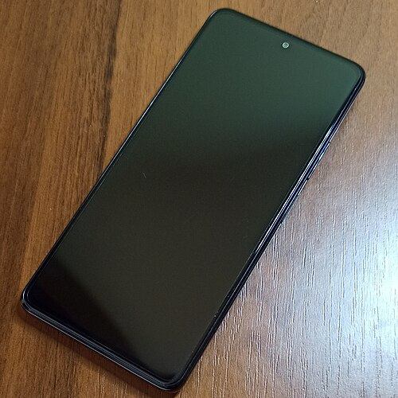

# Running Windows on the Xiaomi Redmi Note 10 Pro

## ⚠️ Warning

We're not responsible for bricked devices, missing recovery partitions, dead xiaomi factoryline ~~workers~~ cowboys, dead pmics, dead ram, dead sim cards, dead display ics, dead cpus, any xiaomi/redmi shenanigans, exploding batteries, dead cats or dogs, nuclear wars or you getting fired because you forgot to boot back in to android for the alarm.

This project is in an early stage. Your bootloader **must be unlocked** , and installing Windows **wipes your data**. Everything is tested through RAM-booting (`fastboot boot`) first — nothing is flashed until you decide to.

**IF YOU AREN'T COMFORTABLE MODDING YOUR PHONE OR ITS PARTITION TABLE OR YOU ARE PARANOID OF BRICKING YOUR DEVICE CLICK AWAY NOW!!! YOU HAVE BEEN WARNED, YOU ARE ON YOUR OWN IF YOU BRICK YOUR DEVICE!!! AGAIN! YOU HAVE BEEN WARNED!!!**

## Get Started

- [Project status](guide/status.md)

- [Installation instructions](guide/install-1.md)

- [Troubleshooting](guide/troubleshooting.md)

## Miscellaneous

- [Optional post-install stuff](guide/postinstall.md)

- [Roll back to Android](guide/troubleshooting.md#roll-back-to-android)

## What is this?

A curated package to boot **Windows 11 ARM64** on the **Redmi Note 10 Pro (sweet, SM7150)**:

| Piece | What it is |
|---|---|
| `boot-sweet.img` | UEFI firmware v2 — SimpleInit GUI, USB mass-storage, **SSDT-power (battery devices)** |
| `sweet_drivers_all\` | 27 signed driver packages + PMFG fuel-gauge battery driver |
| `WLAN-standalone\` | Wi-Fi package separately (byte-identical to the proven miatoll one) |

Built on the [Renegade Project](https://github.com/edk2-porting/edk2-msm) edk2-msm stack (surya base, community SM8180→SM7150 port) with a custom SSDT-power table grafted from the proven miatoll (Project-Aloha) ACPI.

## Contributors

